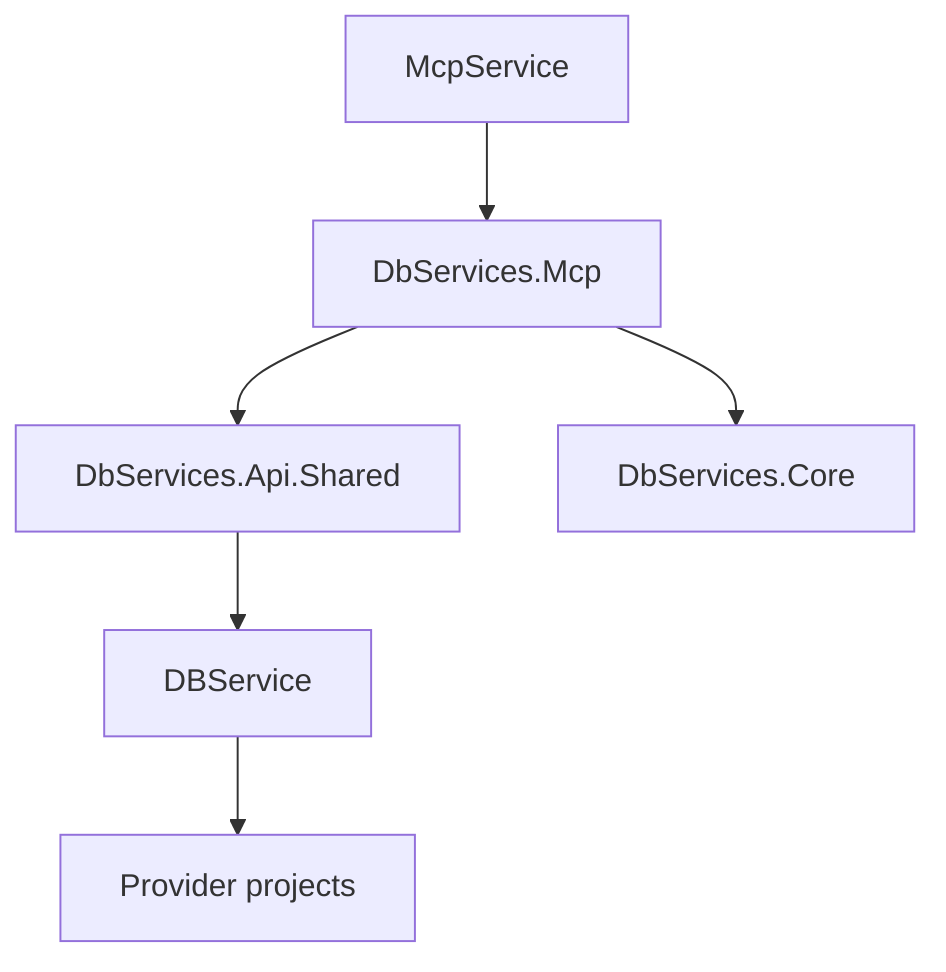
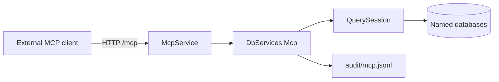

# Architecture Spine — DBServices Agent 資料平面

## Design Paradigm

分層客戶端。MCP 與 CLI、WebService、GraphQL 同層，站在既有 `IQuerySession` 之上。引擎差異留在 Provider。宿主只經 `DbServiceFactory` 取得 `IDbService`，再以既有 `QuerySession` 送出 opcode `Call`。

## Invariants & Rules



### AD-1 — 分層入口 [ADOPTED]

- **Binds:** 所有宿主與 FR-1
- **Prevents:** 宿主直接 new Provider、在工具裡分支引擎，或改寫公開資料存取簽名
- **Rule:** `McpService` 與 `DbServices.Mcp` 不參考任何 `DbServices.Provider.*`。資料服務只來自 `DbServiceFactory.Create`。工具執行只呼叫既有 `QuerySession.Execute`，opcode 為 `Call`。送進 `Execute` 的函式名稱是登錄上的小寫名稱。公開的 `IDbService` 與 `IDbServiceAsync` 簽名維持不變。REST 與 GraphQL 的路徑和查詢形狀維持不變。本產品線不修改 `DbServices.Core`、`FunctionRegistry` 與任何 Provider 專案，也不把 Core 做成會話伺服器。P0 的新程式只有 `McpService` 與 `DbServices.Mcp`。宿主不新增 SQL planner。

### AD-2 — 廣告工具 [ADOPTED]

- **Binds:** FR-3、FR-15
- **Prevents:** 把八條 REST 路由包成工具，或把寫入與自由 SQL 放進清單
- **Rule:** 廣告清單恰好是 `tables`、`fields`、`get`、`query`、`count`、`exists`。名稱比對不區分大小寫。`insert`、`update`、`delete`、`sql` 先判成 `tool_disabled`，不執行 Session Call；其餘不在六個名稱裡的是 `unknown_tool`。這兩種拒絕都進入調度器。工具說明使用既有函式的中文用途，且不寫接受 SQL。六個工具明示 `ReadOnly` 為 true、`Destructive` 為 false；不沿用 SDK 2.2.0 的相反預設。P0 不註冊 MCP resources、prompts 或 sampling。公開表面只有這六個工具。

### AD-3 — 單一調度與參數 [ADOPTED]

- **Binds:** FR-4 至 FR-9、FR-11、FR-12
- **Prevents:** 每個工具各自解析連線，或把欄位條件和宿主參數放在同一層
- **Rule:** 六個工具進入 `DbServices.Mcp` 的同一個調度器。宿主把 JSON 還原成 `null`、布林、字串、Int64 或雙精度浮點數後送進調度器；`JsonElement` 不過界。`tables` 的參數是 `connectionId` 與可省略的 `includeView`；省略時是布林 true。`fields` 的參數是 `connectionId` 與 `table`。`get` 的參數是 `connectionId`、`table` 與 Int64 範圍內的整數 `id`，由調度器轉換一次。`query`、`count`、`exists` 的參數是 `connectionId`、`table` 與可省略的 `filters` 物件。等值條件只放在 `filters`，撲平恰好一層；物件或陣列留在該鍵的值上，不展開、不產生點號鍵。送進 Session 的字典只含該函式會讀的鍵。目錄查找不區分大小寫，只做一次，宿主不預填 `connectionId`。屬性不存在或 JSON `null` 才算省略；空字串是 `unknown_connection`。省略時只在恰有一個組態完整的連線時採用它，否則 `connection_required`。組態完整指 `ServerType` 是 `Sqlite`、`SqlServer`、`MySQL`、`Oracle`、`PostgreSQL` 之一，且 `ConnectionString` 非空白。未列出的頂層鍵是 `invalid_arguments`，在進入調度器之後判定。`filters` 的鍵若與 `connectionId`、`table`、`id`、`includeView`、`connectionString`、`connectString` 相同（不區分大小寫），或兩個篩選鍵只差大小寫，回 `invalid_arguments`，不呼叫 Session。頂層的 `connectionString` 或 `connectString` 同樣拒絕，訊息不含該值，且不建立連線。篩選值以上述純量原樣送進 Session，宿主不把它們拼進 SQL。`Create` 的兩個引數都來自目錄裡的那一筆，任何工具參數都不是連線字串。

### AD-4 — 具名連線組態 [ADOPTED]

- **Binds:** FR-10、FR-13
- **Prevents:** 沿用 WebService 的單一 `ConnectionStrings:default`，或讓宿主與工具庫各做一份目錄
- **Rule:** 組態形狀是 `Connections` 字典，鍵是 `connectionId`，值只有 `ServerType` 與 `ConnectionString`。不讀 `ConnectionStrings` 或 `ServerType:Name`。只由 `DbServices.Mcp` 綁定並保存快照。覆寫順序是 appsettings，然後 user secrets，然後環境變數。啟動只取快照，不呼叫 `Create`。`Create` 發生在該鍵第一次被選中；成功才快取，失敗不快取，下次呼叫可以再試。快取的生命週期等於程序。調度器不另做跨呼叫握住連線的步驟，連線壽命維持既有 `IDbService`。零筆組態完整的連線仍要啟動並廣告六個工具。未知 `ServerType`、空白連線字串，或建立失敗的那一筆不使程序結束。稽核檔不是一筆 `Connections`。

### AD-5 — P0 傳輸 [ADOPTED]

- **Binds:** P0 程序與 FR-2
- **Prevents:** P0 同時出現 stdio 與 HTTP 兩套呼叫者身分和部署方式
- **Rule:** P0 是 `net10.0` 的 ASP.NET Core 程序 `McpService`，套件 `ModelContextProtocol.AspNetCore` 2.2.0。呼叫 `MapMcp("/mcp")`；不使用預設的空路徑。`HttpServerSessionMode` 為 `Stateless`。舊版 SSE 關閉。不加入 OpenAPI、Scalar 或 CORS。聽取位址來自宿主組態，不在程式裡寫死。`AllowedHosts` 出貨值為 `*`。`DbServices.Mcp` 不參考 ASP.NET 型別。MCP 結果只由宿主組裝。

### AD-6 — 呼叫者 [ADOPTED]

- **Binds:** FR-14 的呼叫者欄位
- **Prevents:** 各自定義呼叫者標頭，或在 P0 加入登入
- **Rule:** HTTP 宿主只讀標頭 `X-DBServices-Caller`，把已解析的呼叫者字串送進調度器。空白或不存在記為 `anonymous`，呼叫仍執行。P0 不加入驗證中介軟體。函式庫不讀 HTTP 標頭。日後的 stdio 宿主改由自己的傳輸填同一個字串，不改工具參數。

### AD-7 — 錯誤物件 [ADOPTED]

- **Binds:** FR-11、FR-12、FR-13、FR-15 與工具失敗結果
- **Prevents:** 各工具自訂錯誤碼，或未處理例外結束程序
- **Rule:** 領域失敗由調度器以回傳值表示，不用例外跳過稽核。宿主把它組成 MCP 工具錯誤：`IsError` 為 true，唯一的文字 content 是 JSON 物件，鍵恰好是 `code` 與 `message`。不另放一份 structured content。這不是未處理的 HTTP 500。成功結果的 `IsError` 為 false。`message` 是中文，不含連線字串、密碼與堆疊中的秘密。`code` 只允許下列對應：四個關閉名稱為 `tool_disabled`；其餘不在六個名稱裡的為 `unknown_tool`；名稱不是目錄的鍵為 `unknown_connection`；省略名稱且組態完整的連線不是恰一筆為 `connection_required`；選定項的 `ServerType` 未知、連線字串空白，或 `Create` 回傳 null 為 `connection_failed`；秘密參數名、缺必填參數、非整數 `id`、未列出的頂層鍵、碰撞的 `filters` 鍵為 `invalid_arguments`；`fields` 的缺表檢查為 `unknown_table`；`QueryResult.Kind` 為 `Error`，或稽核那一行寫不進去，為 `execution_failed`。`Kind` 為 `Error` 不是空列成功，也不是 `unknown_table`。這些失敗不讓程序結束。

### AD-8 — fields 的缺表檢查 [ADOPTED]

- **Binds:** FR-5
- **Prevents:** 為了缺表錯誤去改 `IFunctionRegistry`，或讓 `query` 的空結果變成錯誤
- **Rule:** `fields` 先對同一連線呼叫 Session 的 `tables`，`includeView` 為 true。探表結果的 `Kind` 為 `Error` 時回 `execution_failed`，不把空名稱清單當成 `unknown_table`，也不呼叫 `fields`。探表是列結果時，要求的 `table` 與回傳名稱以不區分大小寫的序數比較，不在清單中則回 `unknown_table`，且不再呼叫 `fields`。這次內部 `tables` 不另寫稽核、不另廣告工具。`get`、`query`、`count`、`exists` 不先查表名，也不把缺表改成 `unknown_table`；它們回傳 Session 實際的列結果或 `execution_failed`。

### AD-9 — 成功結果 [ADOPTED]

- **Binds:** FR-4 至 FR-9
- **Prevents:** 各自把 `QueryResult` 編成不同的外層，或讓 `count` 再數一次列
- **Rule:** 成功結果的唯一文字 content 就是下面的 JSON，不再包一層物件，也不另放 structured content。`tables`、`fields`、`get`、`query` 是 JSON 物件，鍵恰好是 `columns` 與 `rows`，且 `Kind` 為 `Rows`。空的 `rows` 是成功。`count` 是 Session 結果裡 `count` 那一格的 JSON 數字。`exists` 是 Session 結果裡 `exists` 那一格的 JSON 布林。儲存格的 JSON：`null` 是 null；布林是布林；整數是數字；雙精度是數字；`byte[]` 是 Base64 字串；`DateTime` 與 `DateTimeOffset` 是 UTC 的 ISO-8601 字串；其餘型別是不變文化的字串。宿主不重算列，不做第二次彙總。

### AD-10 — 稽核 [ADOPTED]

- **Binds:** FR-14
- **Prevents:** 稽核走進 `ILogger` 或另一個資料庫，或把列資料與連線字串寫進紀錄
- **Rule:** 每一次進入調度器的呼叫，含 `tool_disabled` 與 `unknown_tool`，由 `DbServices.Mcp` 追加一行 JSON 到單一檔案。宿主不得在進入前完成工具錯誤。鍵恰好是 `timestamp`、`caller`、`connectionId`、`tool`、`arguments`、`rowCount`、`value`、`error`；沒用到的鍵是 null。`timestamp` 是 UTC 的 ISO-8601。`arguments` 是去掉秘密參數名之後的工具參數。`unknown_connection` 時，頂層 `connectionId` 與 `arguments.connectionId` 都是呼叫方給的字串。`connection_required` 時兩者都是 null。其餘情況的 `connectionId` 是解析後的名稱。`tables`、`get`、`query` 成功時，`rowCount` 等於該次 `QueryResult` 的列數。`fields` 成功時，`rowCount` 只等於後續 `fields` 那次的列數，不含探表。`count` 成功時 `value` 是 JSON 數字；`exists` 成功時 `value` 是 JSON 布林。失敗時 `error` 等於回給客戶端的 `code`，`rowCount` 與 `value` 為 null。不寫結果列。目錄裡的連線字串與其密碼不寫入此檔，也不寫入宿主日誌；結果列同樣不寫入宿主日誌。預設路徑是內容根目錄下的 `audit/mcp.jsonl`。`Audit:Path` 若是相對路徑，由宿主接在內容根之後，把絕對路徑交進函式庫；只有函式庫開啟該路徑。這一行寫不進去時，客戶端得到 `execution_failed`，不回傳本次的列、數字或布林。並行追加不得把一行寫斷。此檔不是工具，也不是 `Connections` 的一筆。宿主不再把同一呼叫寫到第二個稽核儲存。

### AD-11 — 後續表面的邊界 [ADOPTED]

- **Binds:** P1 之後的對談、側車、範本與寫入
- **Prevents:** 側車自己連資料庫，範本保存列資料，或 P0 留下可呼叫的寫入路徑
- **Rule:** P0 不部署 Python，不呼叫語言模型，也沒有側車建置步驟。語言模型不放進 Core 或宿主。日後需要模型的步驟只放在側車，工具契約不隨模型改變。側車不是嵌進 Core 的直譯器，也不是第二條資料庫驅動。它由 C# 啟動。輸入只含連線名稱、工具名稱、結構摘要、語句與範本草稿，不含連線字串與業務列。它不組 SQL、不開連線、不執行查詢，也不把業務列寫進自己的儲存。C# 先確認工具屬於廣告清單、連線名稱已登記，才執行；不合法就不執行，也不改走 `sql`。側車失敗時資料層沒有副作用，對談得到可讀錯誤。P0 沒有範本檔，也沒有確認後寫入的介面。`insert`、`update`、`delete`、`sql` 維持 AD-2 的關閉，直到新的需求明確打開。

## Consistency Conventions

| Concern | Convention |
| --- | --- |
| 專案 | 宿主專案 `McpService`，與 `WebService` 並列，加入現有方案。工具、目錄、稽核、調度放在 `DbServices.Mcp`。 |
| 工具名稱 | 與 `FunctionRegistry` 相同，比對不區分大小寫，送進 Session 的是小寫登錄名。 |
| 連線參數 | 工具與組態都用 `connectionId`，查找不區分大小寫。五個 `ServerType` 字串與 `DbServiceFactory` 的分支相同。 |
| JSON 鍵 | 成功列結果是 `columns`、`rows`。錯誤是 `code`、`message`。兩者都只放在一個文字 content。稽核鍵見 AD-10。 |
| 錯誤碼 | 英文蛇形，見 AD-7。訊息為中文。 |
| 時間 | 稽核 `timestamp` 與日期儲存格都是 UTC ISO-8601。 |
| 組態 | `Connections` 字典與 `Audit:Path`。不新增目錄檔格式。綁定只在 `DbServices.Mcp`。 |
| 呼叫者 | HTTP 標頭 `X-DBServices-Caller`。函式庫只收已解析的字串。 |
| 營運 | P0 不新增健康檢查路由、指標出口，或稽核以外的日誌管線。 |

## Stack

| Name | Version |
| --- | --- |
| .NET | 10.0 (`net10.0`) |
| ModelContextProtocol.AspNetCore | 2.2.0 |
| ModelContextProtocol | 2.2.0 |

## Structural Seed



```text
McpService/            # ASP.NET Core 宿主：組態、Kestrel、MapMcp
DbServices.Mcp/        # 調度、Connections 目錄、稽核寫入、工具描述
```

`McpService` 只參考 `DbServices.Mcp`。`DbServices.Mcp` 參考 `DbServices.Core` 與 `DbServices.Api.Shared`。`DbServices.Api.Shared` 參考 `DBService`。`DBService` 參考五個 Provider 專案。`McpService`、`DbServices.Mcp` 與 `WebService` 都不直接參考 Provider。

部署是一個程序，聽取位址在部署時決定。連線字串只出現在該程序的組態。稽核檔在同一台機器，不外送到別的服務。沒有新的雲端供應商。某個具名連線失敗時，程序與其他連線維持可呼叫。TLS 終止由部署環境處理，工具專案不發憑證。

## Capability → Architecture Map

| Capability / Area | Lives in | Governed by |
| --- | --- | --- |
| FR-1 工廠與簽名 | `DbServiceFactory`、`McpService` | AD-1、AD-4 |
| FR-2、FR-3 工具契約與清單 | `DbServices.Mcp` | AD-2、AD-5 |
| FR-4 `tables` | 調度器 | AD-3、AD-9 |
| FR-5 `fields` | 調度器的缺表檢查 | AD-8、AD-9 |
| FR-6 `get` | 調度器 | AD-3、AD-9 |
| FR-7 `query` | 調度器 | AD-3、AD-9 |
| FR-8 `count` | 調度器 | AD-3、AD-9 |
| FR-9 `exists` | 調度器 | AD-3、AD-9 |
| FR-10、FR-12、FR-13 具名連線 | `Connections` 目錄 | AD-3、AD-4 |
| FR-11 拒絕連線字串 | 調度器 | AD-3、AD-7 |
| FR-14 稽核 | JSONL 寫入 | AD-6、AD-10 |
| FR-15 關閉寫入與 SQL | 調度器 | AD-2、AD-7 |
| P1 之後的側車、範本、寫入 | 尚未有專案 | AD-11 |

## Deferred

- stdio 宿主。日後若做，包同一套 `DbServices.Mcp`，不改工具參數。呼叫者字串由該傳輸填入，見 AD-6。
- 稽核保留天數。P0 由營運者刪除舊檔。
- 健康檢查、指標，以及稽核以外的日誌管線。P0 不加這些出口。
- 授權模型。P0 的界線是營運者的網路、`AllowedHosts` 為 `*`，以及 `anonymous` 仍可呼叫。
- 側車的編譯產物、C# 呼叫方式、逾時與版本對齊。輸入與失敗邊界見 AD-11。
- 報表範本的檔案格式與設計器所在的前端專案。
- `get`、`query`、`count`、`exists` 的缺表是否改成 `unknown_table`。P0 只對 `fields` 的列結果做這項檢查。
- `docs/web/index.md` 的 Sqlite 敘述。不改變 P0 行為。
