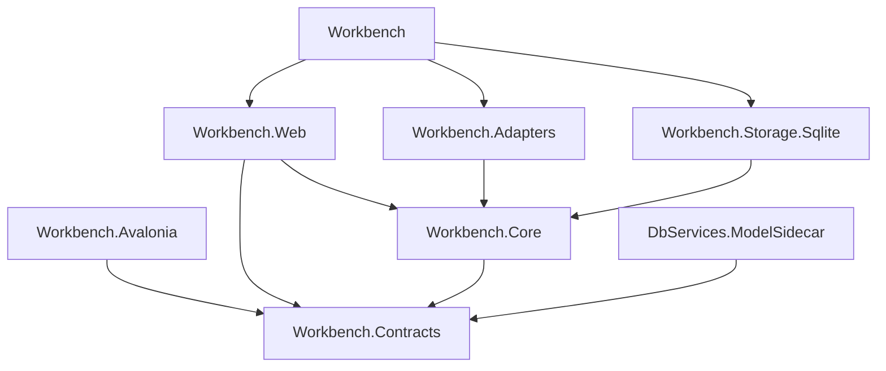
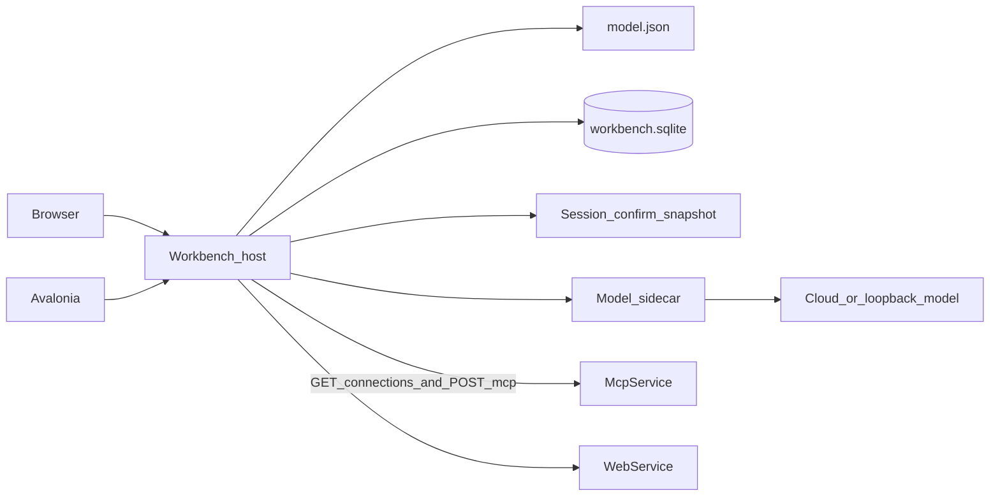

# Architecture Spine — DBServices 報表工作台

本文件的 AD 編號只屬於報表工作台。父脊椎的編號只出現在繼承表，不在此重編。

## Design Paradigm

六角形。`Workbench.Core` 是應用核心：登入、群組角色、範本、確認清單、預覽快照、關鍵字解析、取數軌跡。Blazor 與 Avalonia 是驅動配接器。SQLite、MCP 用戶端、Web API 用戶端、模型側車是被驅動配接器。核心不參考 ASP.NET、Avalonia、`Microsoft.Extensions.AI`、`DbServices.Mcp`、`DbServices.Core` 或任何 Provider。

工作台是資料平面分層客戶端的新同層進程，站在 MCP 與 Web API 之外。它不建立 `IDbService`，不呼叫 `QuerySession`。

## Inherited Invariants

| Inherited | From parent | Binds here |
| --- | --- | --- |
| parent AD-1 | architecture-DBServices-2026-10-11 | 工作台不修改 `IDbService`、`IDbServiceAsync`、`DbServices.Core`、`FunctionRegistry`、Provider，也不改既有 REST 與 GraphQL 的路徑和查詢形狀 |
| parent AD-2 | architecture-DBServices-2026-10-11 | MCP 工具清單維持六個。工作台只呼叫 `tables`、`fields`、`query`、`count`。不呼叫 `get`、`exists`、`insert`、`update`、`delete`、`sql` |
| parent AD-3 | architecture-DBServices-2026-10-11 | `filters` 維持巢狀純量。工作台不把篩選拼進 SQL，不傳送 `connectionString` |
| parent AD-4 | architecture-DBServices-2026-10-11 | `Connections` 仍只由 `DbServices.Mcp` 在 `McpService` 進程綁定。工作台進程不載入連線字串 |
| parent AD-5 | architecture-DBServices-2026-10-11 | MCP 傳輸維持 `McpService` 的 `POST /mcp`，套件 2.2.0 |
| parent AD-6 | architecture-DBServices-2026-10-11 | 呼叫者標頭維持 `X-DBServices-Caller`。工作台送出操作者 `id`。不在 `McpService` 加登入 |
| parent AD-7、parent AD-9 | architecture-DBServices-2026-10-11 | MCP 錯誤碼與成功形狀原樣顯示。工作台不重算列、不把空列改成錯誤 |
| parent AD-8 | architecture-DBServices-2026-10-11 | `unknown_table` 只沿用 `fields` 探表。`query` 與 `count` 不另造缺表碼 |
| parent AD-10 | architecture-DBServices-2026-10-11 | MCP 稽核仍是宿主那一個 JSONL。工作台不寫第二份 MCP 稽核，保留天數仍未定 |
| parent AD-11 | architecture-DBServices-2026-10-11 | 模型不進入 Core 與 MCP 宿主。模型進程由 C# 啟動，不組 SQL、不開資料庫連線。解析輸入不含連線字串與業務列 |

## Invariants & Rules



### AD-1 — 六角形邊界 [ADOPTED]

- **Binds:** 全部 FR
- **Prevents:** 頁面直接呼叫 MCP 或 Web API，或兩個殼各寫一份確認與權限判斷
- **Rule:** 填數、結構呼叫、範本讀寫、角色判斷、解析、軌跡與快照只經過 `Workbench.Core` 的端口。`Workbench.Web` 的 Blazor 元件只參考 `Workbench.Core` 與 `Workbench.Contracts`，在進程內呼叫這些端口。Avalonia 只呼叫 `Workbench` 的 HTTP，JSON 型別就是 `Workbench.Contracts`，HTTP 轉進同一組端口。控制器不另寫業務判斷。兩個殼與 `Workbench.Web` 都不參考 `Workbench.Adapters`、`DbServices.Mcp`、`DBService`、Provider、`Microsoft.Extensions.AI`，也不持有 MCP 或 Web API 的基底網址。`Workbench.Core` 不參考 ASP.NET、Avalonia 與模型套件。

### AD-2 — 單一宿主 [ADOPTED]

- **Binds:** FR-1、FR-16、FR-21、FR-22
- **Prevents:** Avalonia 與網站各開一份 SQLite，或多個執行個體各記一份快照
- **Rule:** 部署恰好一個 `Workbench` 進程。只有它開啟 `Workbench:StorePath` 指向的 SQLite，並在記憶體持有工作階段、待確認清單與預覽快照。Avalonia 不嵌入 Blazor，不開啟該檔。殼的組態只有工作台基底網址。聽取位址來自宿主組態。`AllowedHosts` 出貨值為 `*`。某個業務連線失敗不停止宿主。不另做第二個工作台實例來分攤這些記憶體物件。

### AD-3 — 填數轉發 [ADOPTED]

- **Binds:** FR-4 至 FR-11、FR-20
- **Prevents:** 工作台自算筆數、改寫查詢，或對 Web API 發送多鍵與寫入
- **Rule:** MCP 用戶端在 `Workbench.Adapters`，使用 `ModelContextProtocol` 2.2.0，只呼叫 `tables`、`fields`、`query`、`count`，並帶 `X-DBServices-Caller`。Web API 只發送 `GET /meta`、欄位的 `fieldSet` GET、零鍵的資料表 GET，以及單鍵的 `Key` 與 `Value` 查詢。計數、兩個以上篩選、POST、PUT、DELETE 不發送。範本含計數元件且表面是 Web API 時，整次確認拒絕，填數次數為 0。結果列與計數原樣進入預覽，不做第二次彙總。

### AD-4 — 連線中繼資料 [ADOPTED]

- **Binds:** FR-3、FR-8
- **Prevents:** 工作台進程載入 `ConnectionSnapshot`，或為了列出 `ServerType` 而新增 MCP 工具
- **Rule:** `McpService` 增加 `GET /connections`。它不是 MCP 工具，不掛在 `/mcp` 之下，也不進入六個工具的廣告清單。回應是 JSON 陣列，每筆只有 `name` 與 `serverType`，且只含組態完整的連線。不回傳連線字串，也不回傳是否可用。`Workbench` 與 `Workbench.Adapters` 不參考 `DbServices.Mcp`。Web API 表面的顯示名稱固定為 `default`，`ServerType` 來自工作台組態 `Surfaces:Web:ServerType`，基底網址來自 `Surfaces:Web:BaseUrl`。工作台不讀 WebService 的組態檔。工作台選項類別不宣告連線字串。不修改 WebService 既有路由與 JSON。

### AD-5 — 工作台儲存與帳密三分 [ADOPTED]

- **Binds:** FR-2、FR-15、FR-16、FR-17、FR-21、AD-12
- **Prevents:** 把業務庫帳密、工作台登入密碼與模型金鑰放進同一個可讀欄位，或在業務庫建工作台資料表
- **Rule:** 工作台設定用 `Microsoft.Data.Sqlite` 10.0.12 的單一檔案，路徑 `Workbench:StorePath`。這個檔只放操作者、群組、角色指派、範本、常用項目與關鍵字規則。業務庫帳密只留在 `McpService` 的 `Connections` 與 WebService 的 `ConnectionStrings`。工作台登入密碼只出現在操作者資料表的 `passwordVerifier`，內容是 `PasswordHasher` 驗證材料。模型 `apiKey` 只在 AD-9 的組態。範本沒有連線名稱、參數值與資料列。常用項目有 `surface`（`mcp` 或 `web`）、連線名稱與純量參數值，沒有版面複本與資料列。同一群組內範本名稱唯一。一個操作者對一個群組至多一筆角色。`design` 在讀取時視同 `view`。只有管理員建立操作者、建立群組與變更角色。群組內仍有範本時不能刪該群組。移入自己沒有 `design` 的群組會被拒絕，範本留在原處。`view` 不能建立、修改、刪除或移動範本。清單只含自己有角色的群組。以識別讀取無權限範本時拒絕，填數次數為 0。常用清單只回擁有者自己的項目，管理員的產品介面也不讀他人的常用項目。

### AD-6 — 登入與第一個管理員 [ADOPTED]

- **Binds:** FR-1、FR-2
- **Prevents:** 公開註冊、明文密碼，或 cookie 與 bearer 各算一筆無法一起登出的工作階段
- **Rule:** 沒有註冊端點。儲存裡零個操作者時，宿主讀 `Workbench:InitialAdmin:DisplayName` 與 `Workbench:InitialAdmin:Password`，以 ASP.NET Core 10.0.12 共用框架的 `PasswordHasher` 寫入恰好一個 `admin` 操作者。明文密碼不寫入 SQLite、日誌與軌跡。已有操作者之後這兩個鍵不再使用。缺密碼且零個操作者時，宿主不提供工作台功能。工作階段是宿主記憶體中的一筆：`sessionId` 與操作者 `id`。Blazor 的 cookie 與 Avalonia 的 bearer 都只帶這個 `sessionId`。登出刪除該筆，兩邊同時失效。進程重啟後工作階段清空。未登入的請求不回傳連線、欄位、列、範本或常用項目，也不呼叫 MCP。

### AD-7 — 確認清單與預覽快照 [ADOPTED]

- **Binds:** FR-6、FR-7、FR-19、FR-20、FR-21、FR-22
- **Prevents:** 殼自行組出與畫面不同的呼叫，或離開預覽後仍用舊列匯出
- **Rule:** 結構瀏覽不產生填數清單。活資料預覽的查詢或計數確認，清單恰好一筆 `query` 或一筆 `count`。範本確認的清單由核心產生：每個資料表元件一筆列查詢，MCP 上每個計數元件一筆 `count`，每筆都帶上全部參數合成的等值篩選。任一資料表缺少某個參數欄位時，整次拒絕，填數次數為 0。清單放在宿主記憶體，鍵是操作者 `id` 加上清單識別，值是附錄那個 `calls` 陣列。確認請求帶回該識別。執行前再核對清單、範本、角色與表面能力；不一致則整次拒絕，不部分執行。實際送出的填數呼叫與清單相同。任一筆失敗時預覽只有該錯誤。快照只在同一塊記憶體，值是該次畫面的數字與列。匯出與列印只接受這個識別，且不發出新的填數呼叫。離開該次預覽，或同一操作者的下一次確認，快照與舊清單刪除。同一份快照連續匯出，業務數字相同。快照與清單不寫入 SQLite。PDF 預設 A4，換頁以元件為界。常用項目再次開啟時讀範本目前的版面，套上該筆連線與參數，重新產生清單並確認後才查。範本已刪、失去檢視角色，或參數欄對不齊時，指出差異，停在未確認，填數次數為 0。

### AD-8 — 解析管線 [ADOPTED]

- **Binds:** FR-14、FR-18、FR-19、AD-12
- **Prevents:** 模型與關鍵字各回一份意圖讓殼挑，或把關鍵字寫死成一份不能再長的詞表
- **Rule:** 關鍵字比對在 `Workbench.Core`，不啟動側車，也不讀常用項目。內建比對使用本次看得到的目錄：語句含連線 `name` 則該連線入候選；含範本 `name` 則該範本入候選；含參數 `field` 或 `label` 時，其後第一個不以空白拆開的詞為值，全由數字組成可作數字；對不到的不補猜。時間範圍只有在同一個詞能當某個參數的一個等值時才成為篩選，否則該參數保持缺少，也不另造區間查詢。AD-12 的有效規則再加上去，參數值仍從語句取出，不從規則取出。合併後由宿主計算狀態：恰好一個連線、一個範本且每個參數都有純量值為 `ready`；連線或範本多於一個為 `ambiguous`；沒有連線、沒有範本或缺少參數值為 `incomplete`。模型啟用且狀態不是 `ready` 時，才把附錄的解析輸入送給側車。該輸入只有 `utterance`、連線的 `name` 與 `serverType`、有權限範本的 `id`、`name`、`groupId` 與參數 `field`、`label`，以及允許的 `surfaces`。詞庫不放進這份輸入。宿主重算狀態。候選若超出本次輸入，整份作廢，填數次數為 0。等值篩選的欄必須是該範本的參數欄。設計器建議只做結構呼叫。建議至少含一個資料表元件，其欄名全集等於該次 `fields`。未知欄名不能接受。忽略不改畫布。接受才把元件加到畫布末尾。建議失敗不改畫布。解析失敗不改範本、常用項目與關鍵字規則，填數次數為 0。

### AD-9 — 模型設定 [ADOPTED]

- **Binds:** FR-18 的模型路徑
- **Prevents:** 雲端與本地各做一套客戶端，或測試用的金鑰與解析用的金鑰各存一份
- **Rule:** 有效設定只有一份。欄位是 `enabled`、`placement`（`cloud` 或 `local`）、`endpoint`、`modelId`、`apiKey`、`probeTimeoutSeconds`、`parseTimeoutSeconds`。宿主明確載入內容根的 `model.json`，該檔不在 `wwwroot`。覆寫順序是這個檔、Development 且有 `UserSecretsId` 時的 user secrets、環境變數、命令列。`cloud` 的 `endpoint` 必須是 `https`，且有效金鑰非空白。`local` 的主機必須是 `localhost`、`127.0.0.1` 或 `::1`，金鑰可空白。讀取 API 回傳金鑰是否已設定，不回傳金鑰值。金鑰不進 SQLite、解析 JSON、程序引數、日誌與測試結果。側車每次都設定 `Endpoint`，不使用套件預設的 `https://api.openai.com/v1`。本地金鑰空白時，側車只在進程內使用非空白的佔位憑證 `local`，不把佔位寫入設定檔。

### AD-10 — 測試連線 [ADOPTED]

- **Binds:** 模型設定與 FR-18
- **Prevents:** 殼直接連模型，或探測到的金鑰與事後解析用的金鑰不同卻被當成同一筆
- **Rule:** 只有管理員可測試。測試提交一份草稿，不要求先儲存，也不改 `model.json`。宿主先做 AD-9 的檢查，不通過則回 `model_invalid_settings` 且不啟動側車。通過則啟動側車。標準輸入的 JSON 只有 `kind` 為 `probe`、`placement`、`endpoint`、`modelId`。金鑰只放在該子程序的環境變數 `DBSERVICES_MODEL_API_KEY`：草稿有帶金鑰就用草稿，否則用目前有效設定。解析時不使用草稿，只用有效設定。探測不含語句、範本、連線名稱、資料列與資料庫連線字串，也不把模型回覆內文帶回畫面。結果碼只允許 `model_ok`、`model_invalid_settings`、`model_unreachable`、`model_timeout`。訊息是繁體中文。測試失敗不修改範本、常用項目與關鍵字規則，填數次數為 0。`enabled` 為 false 時，交談仍只走關鍵字規則。

### AD-11 — 模型側車 [ADOPTED]

- **Binds:** FR-18 的模型路徑，以及 parent AD-11
- **Prevents:** 把 `IChatClient` 放進 Blazor、Avalonia、Core 或 MCP 宿主，或為本地模型再引用第二套 SDK
- **Rule:** `DbServices.ModelSidecar` 是 net10.0 的獨立執行檔，由 `Workbench.Adapters` 啟動，標準輸入一筆 JSON、標準輸出一筆 JSON。它只參考 `Workbench.Contracts`、`Microsoft.Extensions.AI` 10.10.0、`Microsoft.Extensions.AI.Abstractions` 10.10.1、`Microsoft.Extensions.AI.OpenAI` 10.10.1。雲端與本地都用這個 OpenAI 相容客戶端。解析請求的 `kind` 是 `parse`，其餘欄位遵守 AD-8。探測遵守 AD-10。預設探測逾時 10 秒、解析逾時 30 秒，逾時則結束子程序並回 `model_timeout`。側車不參考 `DbServices.Core`、Provider、`DbServices.Mcp`，不寫檔，不組 SQL，也不回傳要宿主直接插入的規則命令。發布為自包含執行檔。此功能不部署 Python。

### AD-12 — 可擴充的關鍵字規則 [ADOPTED]

- **Binds:** FR-18
- **Prevents:** 把詞表編譯進程式，或把某次的參數值寫進共用詞庫導致下次沿用舊值
- **Rule:** 關鍵字規則存在工作台 SQLite，後端可繼續新增與停用。一筆規則含 `phrase`、可省略的連線名稱、可省略的範本識別、參數欄名陣列、`source`（`human` 或 `ai`）、建立者與是否有效。沒有參數值、資料列、連線字串、模型金鑰與密碼。`phrase` 非空白，且連線、範本、參數欄名至少有一項。人為新增立即有效：操作者只能為自己看得到的範本加規則；只綁連線名稱時，已登入操作者即可新增。來自 AI 的規則只在操作者確認該次意圖後，按一次加入關鍵字才寫入；`phrase` 可由語句帶入並在寫入前修改，參數只留欄名。模型自行完成的解析不寫入規則。建立者或管理員可把規則改為無效。比對時略過這位操作者現在看不到的範本。解析不讀常用項目。開啟常用項目不查詞庫，直接使用該筆的連線與參數值，再進入 AD-7 的確認。

### AD-13 — 取數軌跡 [ADOPTED]

- **Binds:** FR-9、UJ-1
- **Prevents:** 各畫面自訂一條對不上 MCP 稽核的紀錄
- **Rule:** 每一次結構呼叫與填數呼叫都在畫面上留一筆軌跡。欄位是操作者 `id`、具名連線名稱、工具或請求種類、等值篩選，以及列數、計數值或錯誤碼。不含業務列與連線字串。MCP 成功的 `query`，其呼叫者、連線名稱、工具、篩選與列數必須能在該次 MCP 稽核找到，且稽核呼叫者等於操作者 `id`。MCP 錯誤碼原樣顯示。Web API 沒有那份稽核檔，軌跡仍用同一組欄位，由工作台顯示，不因此修改 WebService。軌跡不寫入工作台 SQLite。

### AD-14 — 畫布與建議 [ADOPTED]

- **Binds:** FR-12、FR-13、FR-14、FR-16
- **Prevents:** 一個故事保存座標，另一個故事用不同的元件欄位
- **Rule:** 元件 `type` 只許 `title`、`text`、`parameter`、`table`、`count`。`order` 從 0 連續，由上到下。不保存 x、y、寬與高。`title` 與 `text` 只有 `text`。`parameter` 恰好一個 `field` 與一個 `label`，不存值。`table` 恰好一個資料表與至少一個欄名。`count` 恰好一個資料表。建議不含業務列與參數值。儲存後的範本沒有資料列、連線字串、具名連線與參數值。

## Consistency Conventions

| Concern | Convention |
| --- | --- |
| 專案 | 新專案加入現有方案：`Workbench`、`Workbench.Web`、`Workbench.Core`、`Workbench.Contracts`、`Workbench.Adapters`、`Workbench.Storage.Sqlite`、`Workbench.Avalonia`、`DbServices.ModelSidecar`、`Workbench.Tests`。目標框架 `net10.0`，Nullable 與 ImplicitUsings 開啟。 |
| 元件 JSON | 見 AD-14。契約在 `Workbench.Contracts`。 |
| 關鍵字規則 | 共用詞庫只存說法到連線、範本與參數欄名。參數值留在該次語句或個人常用項目。 |
| 錯誤 | 工作台自己的錯誤是穩定英文蛇形碼加繁體中文訊息。MCP 錯誤沿用宿主的 `code` 與 `message`。模型碼見 AD-10。訊息不含連線字串、金鑰、密碼與堆疊秘密。 |
| 時間 | 軌跡對照使用 UTC。快照沒有閒置逾時。 |
| 介面文字 | 操作者看得到的工作台文字、空狀態、確認清單與自己產生的錯誤使用繁體中文。 |
| 組態鍵 | `Workbench:StorePath`、`Workbench:InitialAdmin:DisplayName`、`Workbench:InitialAdmin:Password`、`Surfaces:Mcp:BaseUrl`、`Surfaces:Web:BaseUrl`、`Surfaces:Web:ServerType`、`model.json` 的欄位見 AD-9。 |
| 授權 | 群組角色只約束範本。活資料預覽對已登入操作者開放全部已登記具名連線。不做資料表級授權。 |
| HTTP | Avalonia 與 Blazor 進入同一個 Core 方法。Avalonia 的路徑只做轉送。 |

## Stack

| Name | Version |
| --- | --- |
| .NET | 10.0 (`net10.0`) |
| ASP.NET Core Blazor | 10.0.12（共用框架，與 WebService 的 OpenApi 套件帶相同） |
| Avalonia | 12.1.4 |
| Avalonia.Desktop | 12.1.4 |
| Microsoft.Data.Sqlite | 10.0.12 |
| Microsoft.Extensions.AI | 10.10.0 |
| Microsoft.Extensions.AI.Abstractions | 10.10.1 |
| Microsoft.Extensions.AI.OpenAI | 10.10.1 |
| ModelContextProtocol | 2.2.0 |
| ASP.NET Core Identity PasswordHasher | 10.0.12（共用框架） |

## Structural Seed



```text
Workbench/                      # 組裝：DI、聽取位址、沒有畫面
Workbench.Web/                  # Blazor，只參考 Core 與 Contracts
Workbench.Core/                 # 端口與應用規則
Workbench.Contracts/            # 元件、意圖、確認清單、探測與軌跡
Workbench.Adapters/             # MCP、Web API、GET /connections、側車程序
Workbench.Storage.Sqlite/       # 工作台 SQLite
Workbench.Avalonia/             # 桌面殼，只呼叫工作台 HTTP
DbServices.ModelSidecar/        # 自包含側車，唯一的 IChatClient
Workbench.Tests/
McpService/                     # 既有宿主，另加 GET /connections
```

`Workbench` 參考 `Workbench.Web`、`Workbench.Adapters` 與 `Workbench.Storage.Sqlite`。`Workbench.Adapters` 不參考 `DbServices.Mcp`。`DbServices.ModelSidecar` 只參考 `Workbench.Contracts` 與上表的 AI 套件。部署是一個工作台進程，與 `McpService`、`WebService` 分開。側車是子程序，不是常駐服務。模型端點由操作者指定，可以是雲端 `https` 或本機迴圈位址。工作台 SQLite、`model.json` 與那三塊記憶體都在這一個進程。應用本身不新增雲端供應商。TLS 終止由部署環境處理。

## Capability → Architecture Map

| Capability / Area | Lives in | Governed by |
| --- | --- | --- |
| FR-1、FR-2 身分與角色 | `Workbench.Core`、SQLite、記憶體工作階段 | AD-5、AD-6 |
| FR-3 至 FR-8 活資料預覽 | `Workbench.Adapters` | AD-3、AD-4、AD-7 |
| FR-9 取數軌跡 | `Workbench.Core` 的畫面軌跡 | AD-13 |
| FR-10、FR-11 拒絕寫入與可讀錯誤 | 轉發端口 | AD-3、parent AD-7 |
| FR-12 至 FR-17 編輯器與範本庫 | `Workbench.Core`、SQLite | AD-5、AD-14 |
| FR-14 繫結建議 | 結構呼叫端口 | AD-8、AD-14 |
| FR-18 至 FR-20 交談與確認 | 目錄比對、SQLite 詞庫、側車、記憶體清單 | AD-7、AD-8、AD-11、AD-12 |
| FR-21 常用項目 | SQLite | AD-5、AD-7、AD-12 |
| FR-22 匯出與列印 | 宿主記憶體中的快照 | AD-7 |
| 模型設定與測試連線 | `model.json`、側車 `probe` | AD-9、AD-10、AD-11 |

## Deferred

- PDF 與 CSV 的具體套件。產生位置已由 AD-7 固定在宿主的快照上；套件選定時不得再查資料。
- 稽核保留天數。沿用父脊椎，工作台不另定。
- 資料表級授權、SSO、公開註冊、GraphQL 填數、自由 SQL、區間與跨表。PRD 已排除。
- 沒有 OpenAI 相容 HTTP 的本地執行庫。要支援時先修 AD-11，不在殼或 Core 直接引用另一套 SDK。
- 側車若必須改回編譯 Python，先改資料平面附錄與 AD-11，並保持 AD-9 與 AD-10 的設定與探測契約。
