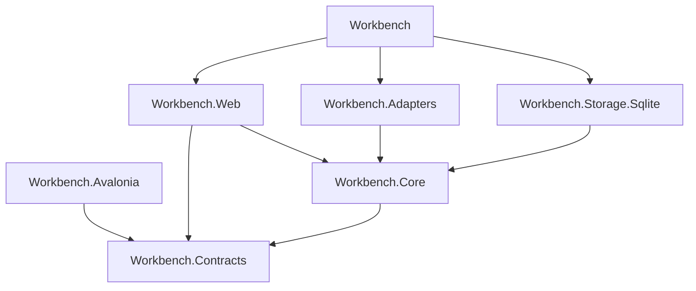
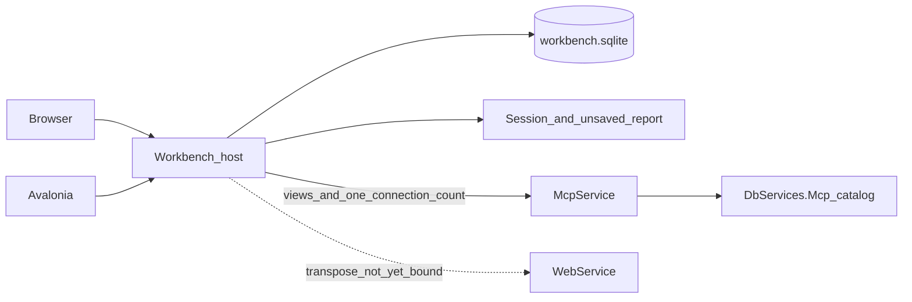

# Architecture Spine — DBServices 檢視與報表

本文件的 AD 編號只屬於這三個入口。父脊椎的編號只出現在繼承表，不在此重編。PRD 的「檢視」就是父脊椎 AD-12 的已發布模組視圖。

## Design Paradigm

六角形。`Workbench.Core` 是應用核心：登入、入口、樣式範本、語句比對、動態報表、報表生成紀錄。Blazor 與 Avalonia 是驅動配接器。SQLite、MCP 用戶端、Web API 用戶端是被驅動配接器。核心不參考 ASP.NET、Avalonia、`Microsoft.Extensions.AI`、`DbServices.Mcp`、`DbServices.Core` 或任何 Provider。

工作台是資料平面分層客戶端的新同層進程，站在 MCP 與 Web API 之外。它不建立 `IDbService`，不呼叫 `QuerySession`。檢視目錄不在這個進程裡。

## Inherited Invariants

| Inherited | From parent | Binds here |
| --- | --- | --- |
| parent AD-1 | architecture-DBServices-2026-10-11 | 不修改 `IDbService`、`IDbServiceAsync`、`DbServices.Core`、`FunctionRegistry`、Provider，也不改既有 REST 與 GraphQL 的路徑和查詢形狀 |
| parent AD-2 | architecture-DBServices-2026-10-11 | Discovery 只列已發布檢視。Chat 只呼叫該樣式所綁的那一個，並帶 `X-DBServices-Caller`。不呼叫 `tables`、`fields`、`get`、`query`、`count`、`exists`，也不呼叫 `insert`、`update`、`delete`、`sql` |
| parent AD-3 | architecture-DBServices-2026-10-11 | 篩選維持純量。工作台不把篩選拼進 SQL，不傳送 `connectionString` |
| parent AD-4 | architecture-DBServices-2026-10-11 | `Connections` 仍只由 `DbServices.Mcp` 在 `McpService` 進程綁定。工作台進程不載入連線字串 |
| parent AD-5 | architecture-DBServices-2026-10-11 | MCP 傳輸維持 `McpService` 的 `POST /mcp`，套件 2.2.0 |
| parent AD-6 | architecture-DBServices-2026-10-11 | 呼叫者標頭維持 `X-DBServices-Caller`。工作台送出操作者 `id`。不在 `McpService` 加登入 |
| parent AD-7、parent AD-9 | architecture-DBServices-2026-10-11 | MCP 錯誤碼與成功形狀原樣顯示。工作台不重算列、不把空列改成錯誤 |
| parent AD-8 | architecture-DBServices-2026-10-11 | 工作台不依賴 `fields` 的 `unknown_table`。MCP 錯誤碼仍原樣顯示 |
| parent AD-10 | architecture-DBServices-2026-10-11 | MCP 稽核仍是宿主那一個 JSONL。工作台不寫第二份 MCP 稽核，保留天數仍未定 |
| parent AD-11 | architecture-DBServices-2026-10-11 | 模型不進入 Core 與 MCP 宿主。三個入口不啟動側車 |
| parent AD-12 | architecture-DBServices-2026-10-11 | 檢視定義不含連線字串與資料列。發布與呼叫都不在來源庫執行 `CREATE VIEW`。沒有連通路徑時不發布、不產生笛卡兒積 |

## Invariants & Rules



### AD-1 — 六角形邊界 [ADOPTED]

- **Binds:** 全部 FR
- **Prevents:** 頁面直接呼叫 MCP 或 Web API，或兩個殼各寫一份入口判斷
- **Rule:** 登入、入口判斷、樣式讀寫、語句比對、動態報表與生成紀錄只經過 `Workbench.Core` 的端口。`Workbench.Web` 的 Blazor 元件只參考 `Workbench.Core` 與 `Workbench.Contracts`，在進程內呼叫這些端口。Avalonia 只呼叫 `Workbench` 的 HTTP，JSON 型別就是 `Workbench.Contracts`，HTTP 轉進同一組端口。控制器不另寫業務判斷。兩個殼與 `Workbench.Web` 都不參考 `Workbench.Adapters`、`DbServices.Mcp`、`DBService`、Provider、`Microsoft.Extensions.AI`，也不持有 MCP 或 Web API 的基底網址。`Workbench.Core` 不參考 ASP.NET、Avalonia 與模型套件。

### AD-2 — 單一宿主 [ADOPTED]

- **Binds:** FR-1、FR-13、FR-16
- **Prevents:** Avalonia 與網站各開一份 SQLite，或多個執行個體各記一份尚未保存的動態報表
- **Rule:** 部署恰好一個 `Workbench` 進程。只有它開啟 `Workbench:StorePath` 指向的 SQLite，並在記憶體持有工作階段與尚未寫入生成紀錄的那份動態報表。Avalonia 不嵌入 Blazor，不開啟該檔。殼的組態只有工作台基底網址。聽取位址來自宿主組態。`AllowedHosts` 出貨值為 `*`。某個業務連線失敗不停止宿主。不另做第二個工作台實例來分攤這些記憶體物件。

### AD-3 — 讀列只走已發布檢視 [ADOPTED]

- **Binds:** FR-7、FR-12、FR-13
- **Prevents:** 工作台用 Web API 組出動態報表，或人在畫面上選擇通道
- **Rule:** MCP 用戶端在 `Workbench.Adapters`，使用 `ModelContextProtocol` 2.2.0。動態報表的列只來自一次已發布檢視呼叫，並帶 `X-DBServices-Caller`。不呼叫 `tables`、`fields`、`get`、`query`、`count`、`exists`。工具引數是頂層的 `connectionId`，加上該檢視已宣告的參數鍵，值是純量。沒有 `filters` 物件。恰有一筆組態完整的具名連線時，適配器送出該 `connectionId`。零筆或多於一筆時不呼叫，讀列次數為 0。成功結果是 `columns` 與 `rows`。空列是成功，不另造錯誤碼。執行只在 `McpService` 依檢視定義即時讀取，不先落地成另一份表。Web API 不是人選擇的表面，也不用來產生動態報表。工作台不重算列。

### AD-4 — 連線不進畫面 [ADOPTED]

- **Binds:** FR-13、parent AD-4
- **Prevents:** 工作台進程載入 `ConnectionSnapshot`，或為了數連線而新增 MCP 工具
- **Rule:** `McpService` 的 `GET /connections` 維持現況。它不是 MCP 工具，不掛在 `/mcp` 之下，也不進入 Discovery。回應是 JSON 陣列，每筆只有 `name` 與 `serverType`，且只含組態完整的連線。不回傳連線字串。三個入口都不渲染這份清單。`Workbench` 與 `Workbench.Adapters` 不參考 `DbServices.Mcp`。工作台選項類別不宣告連線字串。不修改 WebService 既有路由與 JSON。`Surfaces:Web:BaseUrl` 只留給尚未定案的轉置，不出現在畫面上。

### AD-5 — 工作台儲存 [ADOPTED]

- **Binds:** FR-2、FR-10、FR-14、FR-15
- **Prevents:** 把檢視定義或業務連線字串放進工作台 SQLite，或讓樣式範本帶上業務列
- **Rule:** 工作台設定用 `Microsoft.Data.Sqlite` 10.0.12 的單一檔案，路徑 `Workbench:StorePath`。這個檔只放操作者、入口指派、樣式範本與報表生成紀錄。檢視定義不在這個檔。業務庫帳密只留在 `McpService` 的 `Connections` 與 WebService 的 `ConnectionStrings`。工作台登入密碼只出現在操作者資料表的 `passwordVerifier`。驗證材料由 `Workbench.Adapters` 的 `Pbkdf2PasswordHasher` 產生，它實作 `Workbench.Core` 的 `IPasswordHasher`。樣式範本有擁有者、`private` 或 `shared`、名稱、`viewId` 與區塊，沒有連線名稱、參數值與資料列。`viewId` 是目錄的穩定 `id`，不是工具名稱。報表生成紀錄有擁有者、共享範圍、當時的區塊順序與文字、該次 `columns` 與 `rows`、純量參數。沒有連線字串。再開不回讀樣式範本。私有只對擁有者可讀。共享樣式對持有報表設計師或終端使用者入口的人可讀。共享生成紀錄對持有終端使用者入口的人可讀。只有擁有者能改內容或共享範圍。只有管理員建立操作者與變更入口。管理員的產品介面不讀他人的私有生成紀錄。

### AD-6 — 登入與第一個管理員 [ADOPTED]

- **Binds:** FR-1、FR-2、FR-3
- **Prevents:** 公開註冊、明文密碼，或 cookie 與 bearer 各算一筆無法一起登出的工作階段
- **Rule:** 沒有註冊端點。儲存裡零個操作者時，宿主讀 `Workbench:InitialAdmin:DisplayName` 與 `Workbench:InitialAdmin:Password`，以 AD-5 的 `Pbkdf2PasswordHasher` 寫入恰好一個 `admin` 操作者。明文密碼不寫入 SQLite 與日誌。已有操作者之後這兩個鍵不再使用。缺密碼且零個操作者時，宿主不提供三個入口。工作階段是宿主記憶體中的一筆：`sessionId` 與操作者 `id`。Blazor 的 cookie 與 Avalonia 的 bearer 都只帶這個 `sessionId`。登出刪除該筆，兩邊同時失效。進程重啟後工作階段清空。未登入的請求不回傳檢視、樣式、生成紀錄或業務列，也不呼叫 MCP。已登入但沒有該入口時，`Workbench.Core` 拒絕，不建立檢視、不修改樣式、不產生動態報表，讀列次數為 0。

### AD-7 — 動態報表的壽命 [ADOPTED]

- **Binds:** FR-12、FR-13、FR-14、FR-16
- **Prevents:** 殼先組一份確認清單再查，或再開生成紀錄時再呼叫 MCP
- **Rule:** 沒有確認清單。語句未就緒時不呼叫 MCP。就緒後恰好呼叫該樣式所綁的檢視一次。成功的動態報表留在宿主記憶體，鍵是操作者 `id`。內容是當時的區塊順序與文字，加上該次 `columns` 與 `rows`。離開這次報表，或同一操作者產生下一份，這塊記憶體刪除。匯出與列印只接受這塊記憶體或一筆已開啟的生成紀錄，且不發出新的 MCP 呼叫。生成紀錄寫入 SQLite 的是同一份內容。再開只讀這份紀錄，不回讀樣式，也不呼叫 MCP。呼叫失敗時不寫入生成紀錄，也不用舊列湊成成功報表。PDF 由 `Workbench.Adapters` 以 QuestPDF 2026.9.1 產生，預設 A4，換頁以區塊為界。

### AD-8 — 語句比對 [ADOPTED]

- **Binds:** FR-11、FR-12
- **Prevents:** 模型與關鍵字各回一份意圖讓殼挑，或從語句補猜連線
- **Rule:** 比對在 `Workbench.Core`，不啟動側車。輸入只有語句，以及此人可讀樣式的 `id`、`name`、`viewId` 與參數 `field`、`label`。沒有連線清單、取數表面、業務列與連線字串。語句含樣式 `name` 則該樣式入候選；含參數 `field` 或 `label` 時，其後第一個不以空白拆開的詞為值，全由數字組成可作數字；對不到的不補猜。時間範圍只有在同一個詞能當某個參數的一個等值時才成為值。宿主計算狀態：恰好一個樣式且每個參數都有純量值為 `ready`；樣式多於一個為 `ambiguous`；沒有樣式或缺少參數值為 `incomplete`。候選若超出本次輸入，整份作廢，讀列次數為 0。語句候選只含此人可讀的樣式。不可讀的樣式不呼叫 MCP。比對失敗不改樣式與生成紀錄，讀列次數為 0。

### AD-9 — 模型設定 [ADOPTED]

- **Binds:** 既有側車專案，不綁 FR
- **Prevents:** 三個入口各存一份模型金鑰，或為了這一輪把設定畫進模組、樣式或交談
- **Rule:** 三個入口不讀寫模型設定，也不渲染金鑰是否已設定。既有 `model.json` 的欄位與載入順序維持不變，直到另有決定把側車納入路徑。金鑰不進 SQLite、語句 JSON、程序引數與日誌。

### AD-10 — 測試連線 [ADOPTED]

- **Binds:** AD-9
- **Prevents:** 三個入口為了探測模型而啟動側車
- **Rule:** 這一輪沒有測試連線表面。三個入口不接受模型草稿，也不啟動 `kind` 為 `probe` 的側車。

### AD-11 — 模型側車 [ADOPTED]

- **Binds:** parent AD-11
- **Prevents:** 把 `IChatClient` 放進 Blazor、Avalonia、Core 或 MCP 宿主
- **Rule:** `DbServices.ModelSidecar` 仍是倉儲裡的 net10.0 獨立執行檔，套件版本見 Stack。三個入口的適配器不啟動它。它不參考 `DbServices.Core`、Provider、`DbServices.Mcp`。此功能不部署 Python。

### AD-12 — 關鍵字規則 [ADOPTED]

- **Binds:** FR-11
- **Prevents:** 把某次的參數值或連線名稱寫進共用詞庫
- **Rule:** 這一輪的比對只有 AD-8 的即時目錄。三個入口不提供新增或停用詞庫的控制項。日後若把詞庫放進工作台 SQLite，一筆規則不得含參數值、資料列、連線名稱、連線字串或金鑰。

### AD-13 — 不在畫面留軌跡 [ADOPTED]

- **Binds:** parent AD-10
- **Prevents:** 各畫面自訂一條對不上 MCP 稽核的紀錄
- **Rule:** 三個入口不渲染取數軌跡，也不把軌跡寫入工作台 SQLite。MCP 稽核仍只由 `DbServices.Mcp` 寫入那一個 JSONL。工作台不寫第二份。

### AD-14 — 樣式區塊 [ADOPTED]

- **Binds:** FR-8、FR-9、FR-10、FR-15
- **Prevents:** 一個故事保存座標，另一個故事用計數區塊或再綁一張表
- **Rule:** 區塊 `type` 只許 `title`、`text`、`parameter`、`table`。`order` 從 0 連續，由上到下。不保存 x、y、寬與高。`title` 與 `text` 只有 `text`。`parameter` 恰好一個 `field` 與一個 `label`，不存值。一筆樣式的 `viewId` 恰好指向目錄的穩定 `id`。`table` 的欄是該檢視的輸出欄。沒有 `count` 區塊。儲存後的樣式沒有資料列、連線字串、具名連線與參數值。建議的輸入是該檢視的目錄文件，不是語句。建議至少含一個 `table`，其 `columns` 等於輸出欄全集，並為每個已宣告參數各含一個 `parameter` 區塊。建議不含業務列與參數值。未知欄名不能接受。忽略不改區塊。接受才把區塊加到末尾。建議失敗不改既有區塊。

### AD-15 — 檢視目錄歸 MCP [ADOPTED]

- **Binds:** FR-4、FR-5、FR-6、parent AD-12
- **Prevents:** 工作台 SQLite 與 `DbServices.Mcp` 各存一份檢視，或在 `McpService` 再做一套登入
- **Rule:** 檢視定義只存在 `DbServices.Mcp`。`McpService` 不依賴工作台進程就能列出已發布檢視。目錄 HTTP 在 `/mcp` 之外，不是 Discovery 裡的工具。列出是 `GET /views`。讀一筆、保存、刪除是 `GET`、`PUT`、`DELETE`，路徑是 `/views/` 接上 `id`。發布與取消發布是 `POST`，路徑是 `/views/`、`id`、`/publish` 或 `/unpublish`。文件鍵是 `id`、`name`、`purpose`、`published`、`sources`、`links`、`parameters`、`columns`。`links` 的每一段有 `from`、`to`、`by`、`kind`。`kind` 只許 `foreign-key` 或 `accepted`。`id` 穩定。`name` 是 MCP 工具名稱，目錄內不重複，比對不區分大小寫。樣式的 `viewId` 存 `id`。這些路由要求標頭 `X-DBServices-Workbench` 等於兩邊組態的 `Workbench:CatalogKey`。這個鍵不是密碼、不是連線字串，也不寫入 SQLite。空白的 `X-DBServices-Caller` 同樣拒絕。MCP 工具路由不讀 `X-DBServices-Workbench`，工具呼叫仍依父脊椎 AD-6。名稱、輸出欄、參數、來源表或關聯的變更，以及取消發布與刪除，只由 `Workbench.Core` 在確認沒有樣式的 `viewId` 指向該 `id` 之後才發送。`McpService` 不開啟工作台 SQLite，也不做第二套登入。未發布的檢視不在 Discovery。發布表示目的、來源表、關聯、輸出欄與參數已經確認。只有一張來源表時 `links` 為空陣列。兩張以上時每一段的 `kind` 必須是 `foreign-key` 或 `accepted`；否則拒絕保存，不產生笛卡兒積。目的文字可以改，不算結構變更。定義沒有連線字串與資料列。不在來源庫執行 `CREATE VIEW`。

## Consistency Conventions

| Concern | Convention |
| --- | --- |
| 專案 | 沿用現有方案：`Workbench`、`Workbench.Web`、`Workbench.Core`、`Workbench.Contracts`、`Workbench.Adapters`、`Workbench.Storage.Sqlite`、`Workbench.Avalonia`、`DbServices.ModelSidecar`、`Workbench.Tests`、`McpService`、`DbServices.Mcp`。目標框架 `net10.0`。 |
| 三個入口 | 同一組 Blazor 頁與 Avalonia 殼。沒有把三站收成同一條功能軌。一人多個入口時整頁切換。 |
| 樣式 JSON | 見 AD-14。契約在 `Workbench.Contracts`。 |
| 錯誤 | 工作台自己的錯誤是穩定英文蛇形碼加繁體中文訊息。MCP 錯誤沿用宿主的 `code` 與 `message`。訊息不含連線字串、金鑰、密碼與堆疊秘密。 |
| 時間 | 稽核對照使用 UTC。動態報表記憶體沒有閒置逾時。 |
| 介面文字 | 操作者看得到的文字、空狀態與自己產生的錯誤使用繁體中文。 |
| 組態鍵 | `Workbench:StorePath`、`Workbench:InitialAdmin:DisplayName`、`Workbench:InitialAdmin:Password`、`Workbench:CatalogKey`、`Surfaces:Mcp:BaseUrl`、`Surfaces:Web:BaseUrl`。沒有連線字串鍵。 |
| 授權 | 入口加共享範圍。不做資料表級授權。 |
| HTTP | Avalonia 與 Blazor 進入同一個 Core 方法。Avalonia 的路徑只做轉送。 |

## Stack

| Name | Version |
| --- | --- |
| .NET | 10.0 (`net10.0`) |
| Avalonia | 12.1.4 |
| Avalonia.Desktop | 12.1.4 |
| Microsoft.Data.Sqlite | 10.0.12 |
| Microsoft.Extensions.AI | 10.10.0 |
| Microsoft.Extensions.AI.Abstractions | 10.10.1 |
| Microsoft.Extensions.AI.OpenAI | 10.10.1 |
| ModelContextProtocol | 2.2.0 |
| QuestPDF | 2026.9.1 |

版本對過 2026-10-20 的專案檔。共用框架的修補版不在專案檔裡釘死。登入雜湊是專案內的 `Pbkdf2PasswordHasher`。這一輪不新增套件。側車套件留在倉儲，三個入口不啟動側車。

## Structural Seed



```text
Workbench/                      # 組裝：DI、聽取位址、沒有畫面
Workbench.Web/                  # Blazor，只參考 Core 與 Contracts
Workbench.Core/                 # 端口與應用規則
Workbench.Contracts/            # 樣式、意圖、動態報表
Workbench.Adapters/             # MCP 檢視呼叫、目錄 HTTP、連線筆數
Workbench.Storage.Sqlite/       # 操作者、入口、樣式、生成紀錄
Workbench.Avalonia/             # 桌面殼，只呼叫工作台 HTTP
McpService/                     # 既有宿主。GET /connections 已在。目錄寫入在 /mcp 之外
DbServices.Mcp/                 # 檢視目錄與 Discovery
```

`Workbench` 參考 `Workbench.Web`、`Workbench.Adapters` 與 `Workbench.Storage.Sqlite`。`Workbench.Adapters` 不參考 `DbServices.Mcp`。部署是一個工作台進程，與 `McpService`、`WebService` 分開。工作台 SQLite 與尚未保存的動態報表都在這一個進程。檢視目錄在 `McpService` 那一側。應用本身不新增雲端供應商。TLS 終止由部署環境處理。

## Capability → Architecture Map

| Capability / Area | Lives in | Governed by |
| --- | --- | --- |
| FR-1 至 FR-3 登入與入口 | `Workbench.Core`、SQLite、記憶體工作階段 | AD-5、AD-6 |
| FR-4 規劃期表結構 | 通道未定 | Deferred |
| FR-5、FR-6 檢視定義與發布 | `DbServices.Mcp`、`McpService` HTTP | AD-15、parent AD-12 |
| FR-7 轉置 | 現行是 `McpService` 即時讀取。落地另案 | AD-3 |
| FR-8 至 FR-10、FR-15 樣式 | `Workbench.Core`、SQLite | AD-5、AD-14 |
| FR-11、FR-12 語句 | `Workbench.Core` | AD-8、AD-12 |
| FR-13 動態報表 | `Workbench.Adapters` 的一次檢視呼叫、宿主記憶體 | AD-3、AD-4、AD-7 |
| FR-14 生成紀錄 | SQLite | AD-5、AD-7 |
| FR-16 匯出與列印 | 記憶體中的報表，或已開啟的生成紀錄 | AD-7 |

## Deferred

- 規劃期讀取二代平台表結構的通道。定案前不得用待轉資料庫的 `GET /meta` 充當，也不得順手讀業務列。
- 把檢視先落地成另一份資料表。現行執行見 AD-3。要改成落地，先改 AD-3。
- 關鍵字詞庫的新增介面。這一輪只有 AD-8。日後的規則形狀見 AD-12。
- 模型設定、測試連線與側車啟動。專案與 AD-9 至 AD-11 留著，三個入口不進入。
- CSV 的具體寫法。PDF 已由 AD-7 固定。匯出不得再查資料。
- 稽核保留天數。沿用父脊椎，工作台不另定。
- `X-DBServices-Caller` 的身分證明。`McpService` 不加第二套帳號。目錄寫入用 `Workbench:CatalogKey` 辨識工作台進程。
- 本機、測試與正式只差組態。這一輪不新增健康檢查、指標或第二條日誌管線。工作台 SQLite 的備份是營運者複製 `Workbench:StorePath` 那個檔，進程不另做複本。
- 資料表級授權、SSO、公開註冊、GraphQL 填數、自由 SQL、區間與跨表。PRD 已排除。
