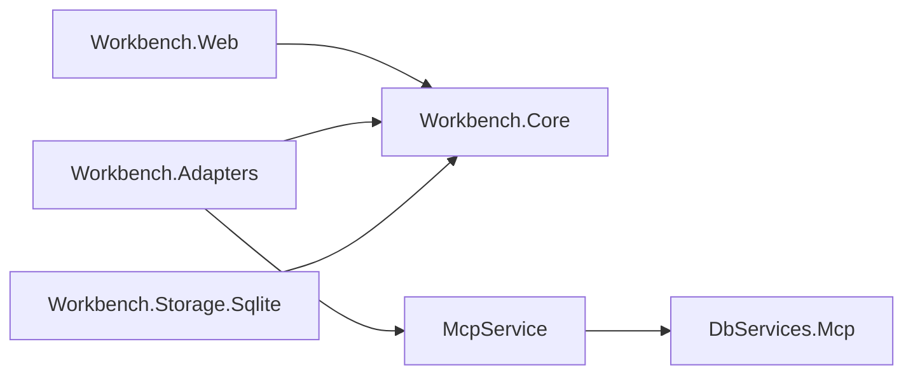
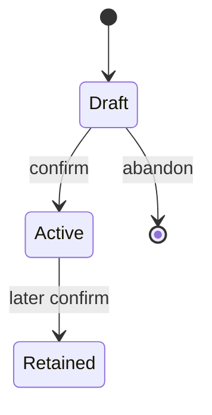

# Architecture Spine — DBServices 資料來源註記

本文件的 AD 編號只屬於資料來源註記。父層編號只出現在繼承表。標成 `[ASSUMPTION]` 的規則在被接受前，不作為實作授權。

## Design Paradigm

六角形，沿用工作台父層。`Workbench.Core` 擁有入口判斷與 Excel 來源形狀。`Workbench.Web` 是驅動配接器。`Workbench.Adapters` 只經 HTTP 呼叫 `McpService`。`DbServices.Mcp` 擁有註記包檔案、再讀合併、DBML 文字、確認對帳與啟用包讀取。`Workbench.Core` 不參考 `DbServices.Mcp`、ASP.NET 或任何 Provider。



## Inherited Invariants

| Inherited | From parent | Binds here |
| --- | --- | --- |
| 10-11 AD-1 | architecture-DBServices-2026-10-11 | 不修改 `IDbService`、Core、Provider、既有 REST 與 GraphQL |
| 10-11 AD-2 | architecture-DBServices-2026-10-11 | Discovery 只列已發布檢視。本文件 AD-4 若被接受，只增加保留名 `source_annotation` |
| 10-11 AD-4 | architecture-DBServices-2026-10-11 | `Connections` 的值仍只有 `ServerType` 與 `ConnectionString`。工作台進程不載入連線字串 |
| 10-11 AD-6 | architecture-DBServices-2026-10-11 | 呼叫者標頭仍是 `X-DBServices-Caller`。註記包的目錄 HTTP 沿用它 |
| 10-11 AD-7 | architecture-DBServices-2026-10-11 | MCP 工具錯誤的封閉清單不改寫。註記站畫面錯誤用本文件 AD-3，不從 AD-7 挑代碼來表示匯入或確認 |
| 10-12 AD-1 | architecture-DBServices-2026-10-12 | `Workbench.Web` 只參考 Core 與 Contracts。核心不參考 `DbServices.Mcp` |
| 10-12 AD-4 | architecture-DBServices-2026-10-12 | `GET /connections` 只回 `name` 與 `serverType`。註記站不渲染連線清單，也不提供選擇連線 |
| 10-12 AD-5 | architecture-DBServices-2026-10-12 | 工作台 SQLite 的內容集合不增加註記包 |
| 10-12 AD-15 | architecture-DBServices-2026-10-12 | 檢視文件仍只在 `DbServices.Mcp`。`ViewLink.kind` 仍只許 `foreign-key` 或 `accepted`。目錄寫入仍要 `X-DBServices-Caller` 與 `X-DBServices-Workbench` |

## Invariants & Rules

### AD-1 — 註記包單一目錄 [ASSUMPTION]

- **Binds:** prd-2026-11-12:FR-2、FR-4、FR-5、FR-6
- **Prevents:** 工作台 SQLite 與 `DbServices.Mcp` 各存一份註記包，或 Excel 再匯入與資料庫再讀各寫一套合併
- **Rule:** 持久化檔在 `McpService` 內容根，組態鍵 `Catalog:AnnotationsPath`，預設 `catalog/annotations.json`。只由 `DbServices.Mcp` 的一個目錄型別寫入。文件鍵是 `id`、`title`、`purpose`、`status`、`active`、`tables`、`links`、`dbml`。`status` 只許 `draft` 或 `confirmed`。`draft` 的 `active` 是 false。`confirmed` 且 `active` 為 true 的文件同時最多一份。被取代的包留在檔內，`status` 仍是 `confirmed`，`active` 改為 false。工作中草稿同時最多一份。從啟用包開始編輯是另寫一份 `draft`，不改該筆 `confirmed`。放棄草稿只刪該筆 `draft`。檔內沒有 `connectionString` 與 `rows`。Excel 活頁簿只在 `Workbench.Core` 剖析成來源形狀，再交給這個目錄。再讀合併只在這個目錄：比對鍵是實體表名加實體欄名，去掉首尾空白後以區分大小寫的序數比較；同鍵的人寫註記保留；來源沒有的鍵不把註記搬到新名。DBML 文字只由這個目錄從結構化內容產生。確認時在同一目錄重算 `dbml`。設計端與匯出下載都不讀確認前另存的檔案。匯出檔名是 `title` 加 `.dbml`；`title` 不得含 `\ / : * ? " < > |`。此檔的備份是營運者複製該目錄檔，進程不另做複本。

### AD-2 — 二代平台連線 [ASSUMPTION]

- **Binds:** prd-2026-11-12:FR-3、FR-5、FR-6
- **Prevents:** 在 `Connections` 的值裡加角色欄，或由瀏覽器傳入 `connectionId` 來決定讀哪一座庫
- **Rule:** `McpService` 組態鍵 `Annotation:PlatformConnection` 的值是連線名稱。`Connections` 的值仍只有 `ServerType` 與 `ConnectionString`。組態完整沿用父層：`ServerType` 是 `Sqlite`、`SqlServer`、`MySQL`、`Oracle`、`PostgreSQL` 之一，且 `ConnectionString` 非空白。名稱比對不區分大小寫。讀結構與確認對帳只在組態完整的連線恰有一筆，且該名稱等於 `Annotation:PlatformConnection` 時發生。零筆、多於一筆，或那一筆名稱不等，都不呼叫 `SchemaGraph.Read`。讀結構的路由忽略請求裡的 `connectionId`。實作路徑是既有 `SchemaGraph.Read`。不呼叫 `SchemaGraph.Preview`，不呼叫待轉庫的 `GET /meta`，不執行會返回業務列的查詢。表清單為空仍是成功，並可寫成草稿。`Workbench.Web` 不呼叫既有 `GET /schema/graph` 來組註記或設計清單。

### AD-3 — 註記站錯誤碼 [ASSUMPTION]

- **Binds:** prd-2026-11-12:FR-1 至 FR-8 的註記站與設計站拒絕
- **Prevents:** 各故事自訂代碼字面，或把 10-11 AD-7 的工具代碼拿來表示匯入與確認
- **Rule:** 註記站與設計站新產生的失敗，代碼只許下列各項。訊息是繁體中文，不含連線字串、密碼與堆疊中的秘密。讀結構或對帳若進入 `SchemaGraph.Read` 後失敗，代碼與訊息沿用該方法已有的 `connection_failed` 與 `execution_failed`，不另造同義代碼。目錄檔寫入失敗的代碼是 `execution_failed`，訊息是「沒有保存。」非管理員的入口指派沿用既有 `forbidden` 與「沒有權限。」

| 代碼 | 時機 | 訊息 |
| --- | --- | --- |
| `import_rejected` | 活頁簿對不上契約 | 無法匯入。這份活頁簿對不上字典契約。既有草稿沒有改。 |
| `draft_exists` | 已有草稿時，Story 1.6 以外的匯入或讀結構 | 已有工作中的草稿，沒有改。 |
| `no_connection` | 組態完整的連線是零筆 | 沒有讀取結構。 |
| `connection_unselectable` | 組態完整的連線多於一筆 | 註記站不能選擇連線，沒有讀取結構。 |
| `not_platform_source` | 恰有一筆，名稱不等於 `Annotation:PlatformConnection` | 不能用{連線名稱}讀結構或確認。 |
| `confirm_incomplete` | 說明空白、零張表或零個欄 | 無法確認。整包功能說明要有內容，而且至少要有一張表、一個欄。 |
| `confirm_unmatched` | 實體表名或實體欄名對不上 | 無法確認。這些表或欄對不上來源：{名稱}。 |
| `confirm_blocked` | 已保存檢視會落到新包之外 | 無法確認。這些檢視會落到新包之外：{檢視名稱}。 |
| `link_outside` | 已聲明關聯的一端不在本包 | 關聯的一端不在這份註記包裡。 |
| `link_undeclared` | 檢視的一段關聯對不上已聲明關聯 | 這段關聯不在註記包裡。 |

`connection_unselectable` 的訊息就是表上那一句，不另接連線名稱。名稱以頓號接在 `confirm_unmatched` 與 `confirm_blocked` 的冒號之後。

### AD-4 — 啟用包的引用表面 [ASSUMPTION]

- **Binds:** prd-2026-11-12:FR-7、FR-8
- **Prevents:** 設計清單讀即時結構，而 MCP 客戶端讀到另一份包；或在沒有啟用包時回退成表級工具
- **Rule:** 此假設接受前，Discovery 仍完全遵守 10-11 AD-2，不註冊註記工具。接受後，Discovery 的名稱集合等於已發布檢視的名稱，再加上保留名 `source_annotation`，而且只在存在 `active` 已確認包時加入該名。沒有啟用包時，該名不在 Discovery；對該名的呼叫回 `unknown_tool`，不呼叫 `SchemaGraph.Read`，也不回退成 `tables`、`fields`、`get`、`query`、`count`、`exists`。工具沒有參數，不接受 `connectionId` 或 SQL。結果是啟用包的表、欄、型別、註解與已聲明關聯。不含業務列與連線字串，也不含 `draft` 與 `active` 為 false 的包。`ReadOnly` 為 true，`Destructive` 為 false。檢視 `name` 不得與 `source_annotation` 相同，比對不區分大小寫。模組設計工具的左側清單與這個工具讀同一個目錄方法。設計工具不連二代平台資料源，也不連待轉資料庫。

目錄 HTTP 在 `/mcp` 之外，寫入條件與檢視目錄相同：

| 方法與路徑 | 作用 |
| --- | --- |
| `GET /annotations/active` | 讀啟用包。沒有則空結果，不是錯誤 |
| `PUT /annotations/draft` | 以來源形狀或編輯結果寫入唯一草稿 |
| `DELETE /annotations/draft` | 放棄草稿 |
| `POST /annotations/read-structure` | 依 AD-2 讀結構並合併進草稿 |
| `POST /annotations/confirm` | 依 AD-2 對帳、檢查檢視落點、切換啟用包 |
| `GET /annotations/draft/dbml` | 回傳目前草稿的 DBML 文字 |

`POST /annotations/confirm` 對檢視落點的判斷在 `DbServices.Mcp`，讀的是檢視目錄裡已保存文件的來源表、輸出欄與關聯端點。

### AD-5 — 關聯進檢視的 kind [ASSUMPTION]

- **Binds:** prd-2026-11-12:FR-4、FR-7、10-12 AD-15
- **Prevents:** 一則故事把人寫的關聯存成 `foreign-key`，另一則存成新的 kind 字面
- **Rule:** 註記包 `links` 的每一段有 `from`、`fromColumn`、`to`、`toColumn`、`origin`、`note`。`origin` 只許 `foreign-key` 或 `declared`。資料庫外鍵預填為 `foreign-key`，理由可空。人新增、庫裡沒有的關聯是 `declared`。寫入 `ViewDocument.links` 時，`foreign-key` 變成 `kind` `foreign-key`，`declared` 變成 `kind` `accepted`。不新增第三種 `kind`。比對已聲明關聯時，兩端表與欄對調仍算同一段。檢視保存不改 `ViewDocument` 的欄位集合。

### AD-6 — 資料治理入口 [ADOPTED]

- **Binds:** prd-2026-11-12:FR-1、UX-DR1
- **Prevents:** 另做一套帳號表，或在 Avalonia 殼加一個資料治理導覽
- **Rule:** 入口代碼是 `governance`，顯示名稱是「資料治理」，路徑是 `/governance`。指派寫入工作台既有的入口存放。`EntryNames` 增加這個代碼。只有這個入口時，登入後進入 `/governance`。註記站在 `Workbench.Web` 的 `WorkbenchLayout`。Avalonia 這一輪不新增該入口，也不新增該路徑。



`Draft` 是唯一工作中草稿。`Active` 是 `confirmed` 且 `active`。`Retained` 是 `confirmed` 且不是 `active`。

## Consistency Conventions

| Concern | Convention |
| --- | --- |
| 命名 | 目錄型別與路由用 annotation。MCP 保留名是 `source_annotation`。入口代碼是 `governance` |
| 錯誤形狀 | 物件鍵是 `code` 與 `message`。代碼為英文蛇形，取自 AD-3 或既有的 `connection_failed`、`execution_failed`、`forbidden`、`unknown_tool` |
| 狀態變更 | 註記包檔案只由 AD-1 的目錄型別寫入。確認成功才把上一份啟用包的 `active` 改成 false |
| 紀錄 | 註記站不寫第二份稽核，也不把業務列或連線字串寫入日誌 |

## Stack

不新增套件，也不升版。宿主仍是既有的 `net10.0` 工作台與 `McpService`。註記包不是 SQLite 資料表。

## Structural Seed

```text
DbServices.Mcp/                 # 註記包目錄、合併、DBML、確認對帳
McpService/                     # /annotations 路由與 source_annotation
Workbench.Core/                 # Excel 來源形狀、入口代碼判斷
Workbench.Adapters/             # 註記目錄的 HTTP 用戶端
Workbench.Web/                  # /governance 註記站
catalog/annotations.json        # 預設檔名，位於 McpService 內容根
```

部署仍是現有的工作台進程與 `McpService` 進程。不新增雲端供應商、健康檢查或第二條日誌。

## Capability → Architecture Map

| Capability / Area | Lives in | Governed by |
| --- | --- | --- |
| FR-1 資料治理入口 | `Workbench.Core`、既有 SQLite 入口表、`Workbench.Web` | AD-6、10-12 AD-5 |
| FR-2 Excel 草稿 | `Workbench.Core` 剖析，目錄寫入在 `DbServices.Mcp` | AD-1、AD-3 |
| FR-3 讀結構 | `McpService` 依 AD-2 呼叫 `SchemaGraph.Read` | AD-2、AD-3 |
| FR-4 四層編輯 | 目錄檔內的草稿 | AD-1、AD-5 |
| FR-5 匯出與確認 | 目錄產生 DBML；確認在 `DbServices.Mcp` | AD-1、AD-2、AD-3 |
| FR-6 再讀與放棄 | 目錄的合併與刪除草稿 | AD-1、AD-2 |
| FR-7 設計清單與關聯 | `GET /annotations/active`，檢視 kind 對照 AD-5 | AD-4、AD-5、10-12 AD-15 |
| FR-8 檢視契約與 MCP 引用 | 檢視文件不變；`source_annotation` | AD-4、10-11 AD-2 |

## Deferred

- AD-4 被接受之前，不實作 `source_annotation`，Discovery 維持父層 AD-2。
- 說明文件的讀者與用途未定，本脊椎不附帶第二份敘述文件。
- 第二種 Excel 版型、深色模式、Avalonia 的資料治理入口、AI 輔助建立檢視，仍不在這一層決定。
---
