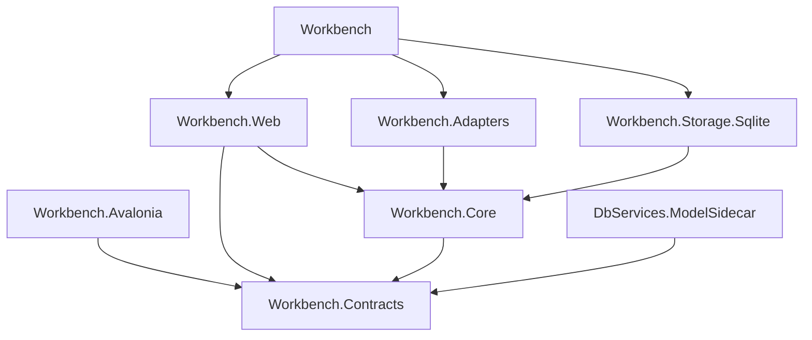
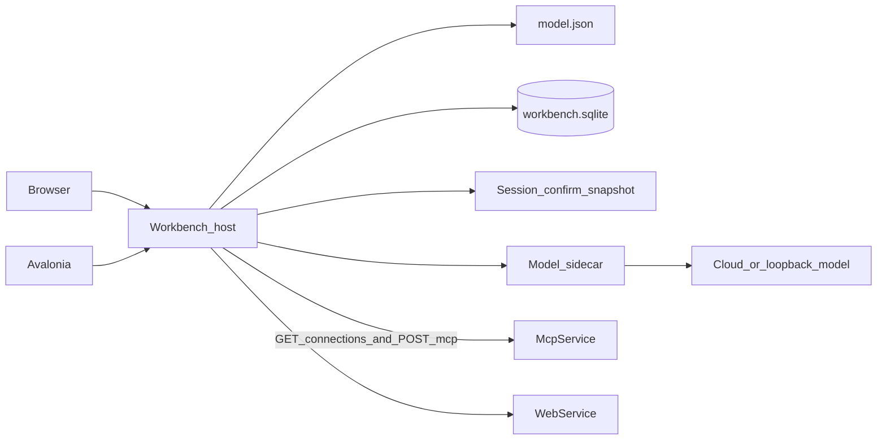

# 架構圖

## 依賴

`Workbench.Web` 的 Blazor 在進程內呼叫 Core。Avalonia 只依賴契約，經宿主 HTTP 進入同一組端口。側車只依賴契約。儲存與配接器實作 Core 的端口。



## 執行

一個工作台進程持有 SQLite、`model.json`，以及工作階段、確認清單與預覽快照。側車是子程序，連到操作者指定的雲端 `https` 或本機迴圈位址。業務庫連線留在 `McpService` 與 `WebService`。



## 專案樹

```text
Workbench/                      # 組裝：DI、聽取位址、沒有畫面
Workbench.Web/                  # Blazor，只參考 Core 與 Contracts
Workbench.Core/                 # 端口與應用規則
Workbench.Contracts/            # 元件、意圖、確認清單、探測與軌跡
Workbench.Adapters/             # MCP、Web API、GET /connections、側車程序
Workbench.Storage.Sqlite/       # 工作台 SQLite
Workbench.Avalonia/             # 桌面殼，只呼叫工作台 HTTP
DbServices.ModelSidecar/        # 自包含側車，唯一的 IChatClient
Workbench.Tests/
McpService/                     # 既有宿主，另加 GET /connections
```
