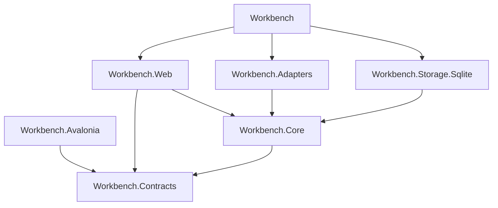
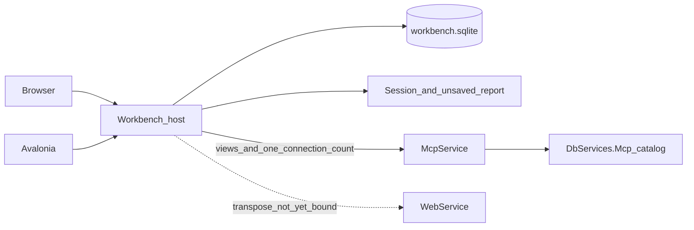

# 架構圖

## 依賴

Blazor 在進程內呼叫 Core。Avalonia 只依賴契約，經宿主 HTTP 進入同一組端口。儲存與配接器實作 Core 的端口。側車不在這張圖裡：倉儲留著專案，三個入口不啟動它。



## 執行

瀏覽器與 Avalonia 都進入同一個工作台進程。檢視目錄在 `McpService`。Web API 的箭頭是尚未綁定的轉置，不用來產生動態報表。



## 專案

```text
Workbench/                      # 組裝：DI、聽取位址、沒有畫面
Workbench.Web/                  # Blazor，只參考 Core 與 Contracts
Workbench.Core/                 # 端口與應用規則
Workbench.Contracts/            # 樣式、意圖、動態報表
Workbench.Adapters/             # MCP 檢視呼叫、目錄 HTTP、連線筆數
Workbench.Storage.Sqlite/       # 操作者、入口、樣式、生成紀錄
Workbench.Avalonia/             # 桌面殼，只呼叫工作台 HTTP
McpService/                     # 既有宿主。GET /connections 已在。目錄寫入在 /mcp 之外
DbServices.Mcp/                 # 檢視目錄與 Discovery
```

`Workbench.Tests` 與 `DbServices.ModelSidecar` 沿用現有方案。側車不參考 `DbServices.Core`、Provider 或 `DbServices.Mcp`。
