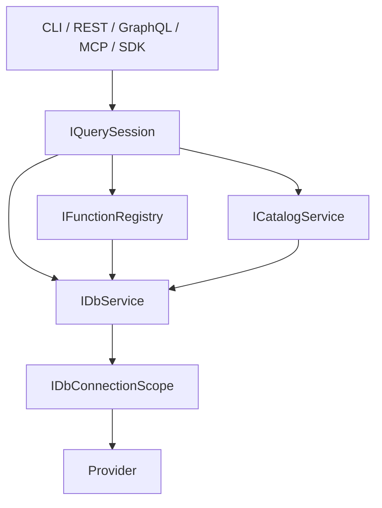

# 分層

| 層 | 專案 | 職責 |
|----|------|------|
| 門面 | `DBService` | `MainService`、`DbServiceBuilder`、DI 擴充 |
| 核心 | `DbServices.Core` | `DataBaseService`、Session、Catalog、Functions、事務、遷移、選項 |
| 提供者 | `DbServices.Provider.*` | `DbConnection` 工廠、方言 `SqlProviderBase` |
| 客戶端 | `DbServices.Cli`、`WebService`、`GraphQLService`、`McpService` | 把輸入展開成 Session 請求、REST、GraphQL 或 MCP 工具 |
| 共用工廠 | `DbServices.Api.Shared` | `DbServiceFactory`：依 `ServerType` 建立 `IDbService` |
| Agent 工具 | `DbServices.Mcp` | 已發布模組視圖的 Discovery、調度與稽核；表級工具若保留只作除錯；不建立 Provider |

反斜線指令只活在 CLI。EZIE 不內嵌在此儲存庫；連線用 `connectionId`。
